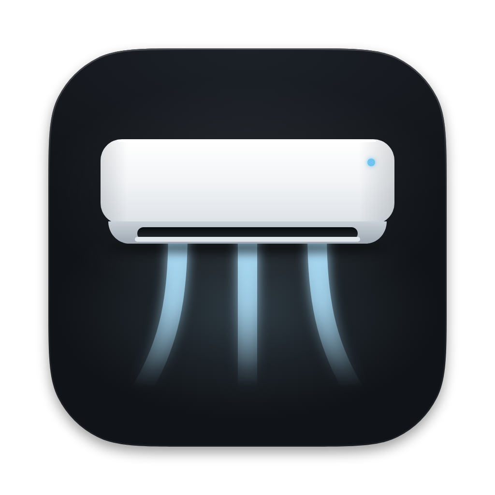
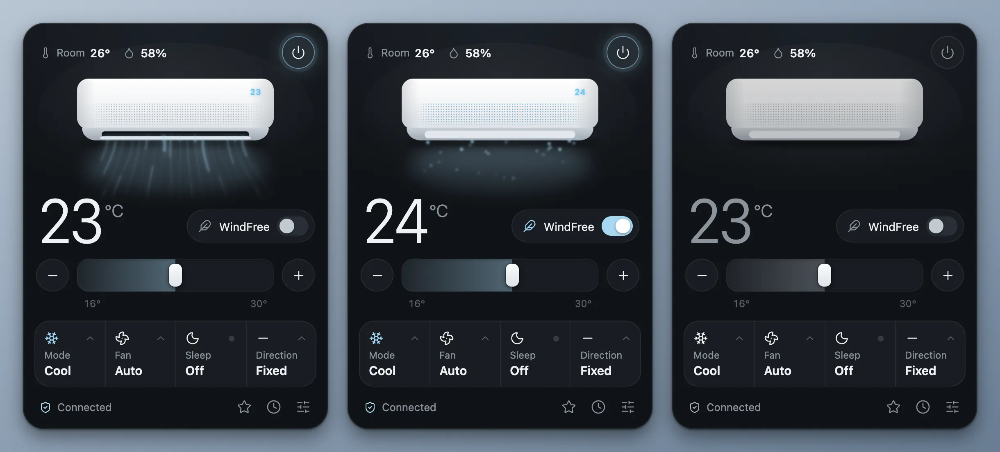
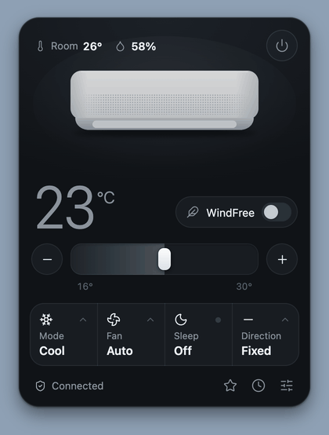
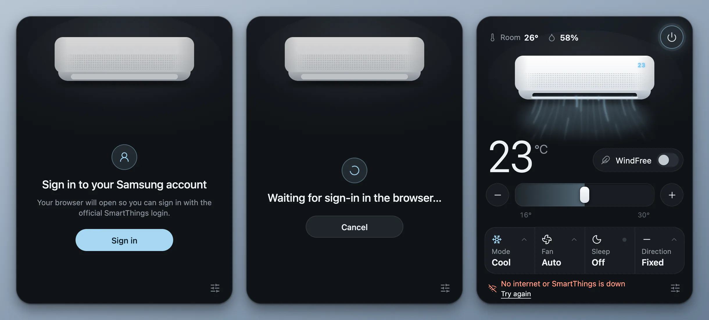
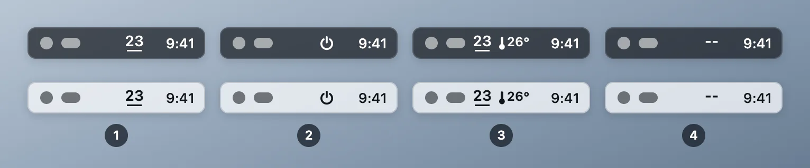
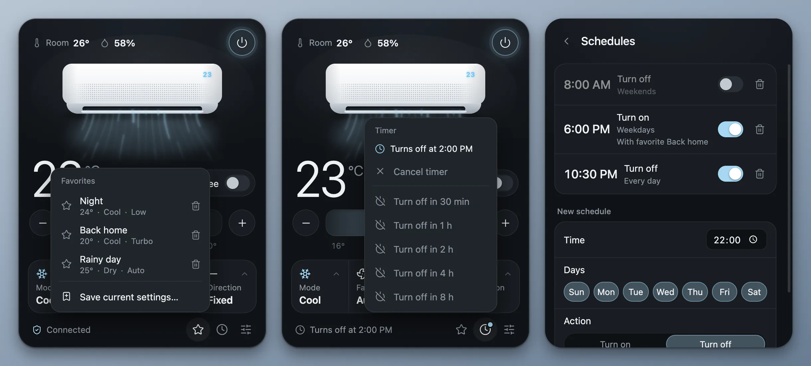
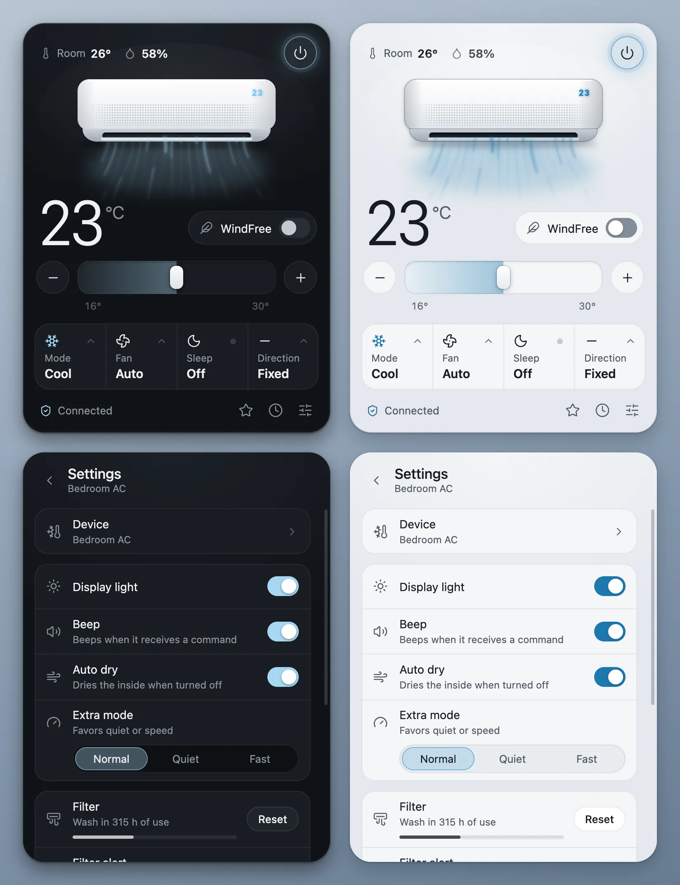
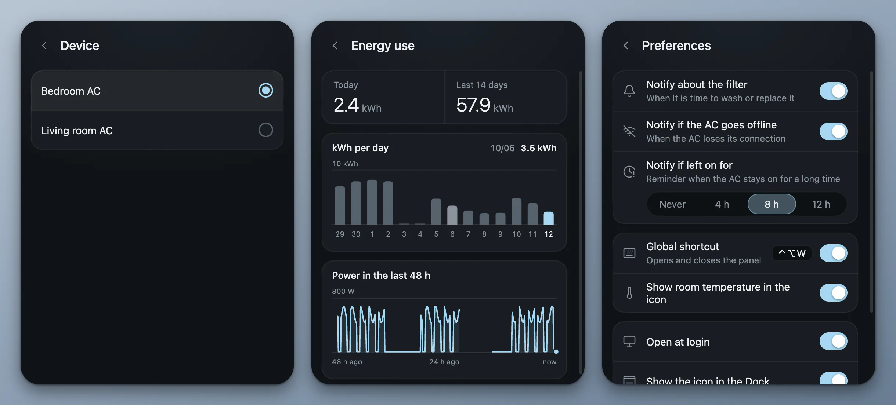
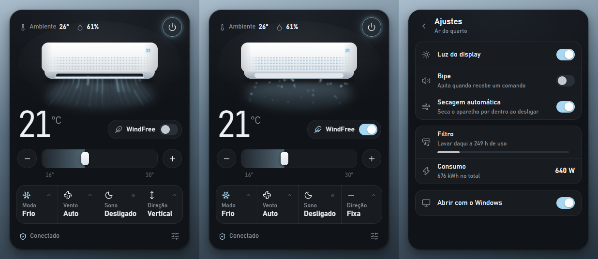

<p align="right"><a href="README.md">Português</a> · <b>English</b></p>

<div align="center">
  
  <h1>WindFree</h1>
  <p>Control your Samsung WindFree air conditioner from the Mac menu bar or the Windows tray.</p>
</div>

<p align="center">
  <a href="https://github.com/kevinnfsilva/samsung-windfree-menubar-app/releases/latest/download/WindFree-arm64.dmg"></a>
  &nbsp;
  <a href="https://github.com/kevinnfsilva/samsung-windfree-menubar-app/releases/latest/download/WindFree-x64.dmg"></a>
</p>

<p align="center">
  <sub>Not sure which Mac you have? Apple menu &gt; <b>About This Mac</b>: "Chip" means Apple Silicon, "Processor" means Intel. Needs macOS 13 or newer. For Windows, see <a href="#on-windows">On Windows</a>.</sub>
</p>

<p align="center">
  <a href="https://kevinnfsilva.github.io/samsung-windfree-menubar-app/">Download page</a> ·
  <a href="https://github.com/kevinnfsilva/samsung-windfree-menubar-app/releases/latest">Release notes</a>
</p>

<p align="center">Prefer to install without the macOS warning? Paste this line into Terminal:</p>

```sh
curl -fsSL https://raw.githubusercontent.com/kevinnfsilva/samsung-windfree-menubar-app/main/install.sh | bash
```

<div align="center">
  <p>
    <a href="https://github.com/kevinnfsilva/samsung-windfree-menubar-app/releases/latest"></a>
    
    
    
  </p>
  <p>
    <a href="#download-for-mac">Download for Mac</a> ·
    <a href="#what-it-does">What it does</a> ·
    <a href="#usage">Usage</a> ·
    <a href="#run-from-source">Source code</a> ·
    <a href="#on-windows">Windows</a> ·
    <a href="#command-line">Command line</a> ·
    <a href="#common-problems">Common problems</a>
  </p>
</div>

<p align="center">
  
</p>

A menu bar panel for the Mac that controls your Samsung WindFree air conditioner through SmartThings. The icon shows the target temperature, and one click opens the panel.

This project is based on the [Windows tray app](https://github.com/c0dag/samsung-windfree-tray-app) by [@c0dag](https://github.com/c0dag), ported here to the macOS menu bar. The original's Windows support was kept.

<p align="center">
  
</p>

<p align="center"><sub>The images and the demo come from the real panel code, with a simulated unit. The pointer in the video was drawn on top.</sub></p>

## Download for Mac

You need:

- macOS 13 or newer
- Your AC already set up in the SmartThings app, on a Samsung account

You do not need to install Node.js: the installed app brings everything it uses.

Pick the file for your Mac. The links always point to the latest release:

| Your Mac | File |
|---|---|
| Apple Silicon (M1 or newer) | [`WindFree-arm64.dmg`](https://github.com/kevinnfsilva/samsung-windfree-menubar-app/releases/latest/download/WindFree-arm64.dmg) |
| Intel | [`WindFree-x64.dmg`](https://github.com/kevinnfsilva/samsung-windfree-menubar-app/releases/latest/download/WindFree-x64.dmg) |

Not sure? Open the Apple menu and choose **About This Mac**. If it says "Chip", it is Apple Silicon. If it says "Processor", it is Intel.

The same choices, with explanations, are on the [download page](https://kevinnfsilva.github.io/samsung-windfree-menubar-app/). There are two ways to install: from the Terminal, without the macOS warning, or by opening the DMG.

### Install from Terminal (no warnings)

Paste this line into Terminal (in Applications > Utilities) and press Return:

```sh
curl -fsSL https://raw.githubusercontent.com/kevinnfsilva/samsung-windfree-menubar-app/main/install.sh | bash
```

The script downloads the right DMG for your Mac (Apple Silicon or Intel), checks that it holds WindFree, copies the app into the **Applications** folder and opens it. It does not ask for your password: if Applications is not writable for your user, it uses `~/Applications`. If WindFree is already installed, the old copy is replaced. With the app open, the script asks it to quit and waits a few seconds; if it does not quit, the script stops without changing anything and asks you to quit from the icon's menu.

**Why does this avoid the warning?** macOS only shows the warning for files with the quarantine mark ("downloaded from the internet"), which browsers put on everything they download. `curl` does not put that mark, so an app installed this way opens normally. The app is still not notarized; it just skips the first-launch block.

The script is [`install.sh`](install.sh), plain text you can read before running it. It only deletes its own temporary folders and the previous `WindFree.app`. For tests or mirrors it accepts three environment variables: `WINDFREE_DMG_URL` (download this DMG instead of the latest release's), `WINDFREE_INSTALL_DIR` (install into this folder instead of Applications) and `WINDFREE_NO_OPEN=1` (do not open the app at the end). Messages are in Portuguese when the Terminal language (`LANG`) is Portuguese, and in English otherwise.

### Install from the DMG

1. Open the DMG and drag **WindFree** to the **Applications** folder.
2. Open WindFree from the Applications folder. The first time, macOS blocks it; see just below for how to allow it.
3. The panel opens right away. The app gets an icon in the menu bar, near the clock, and another in the Dock. To keep it in the menu bar only, turn off **Show the icon in the Dock** in **Settings > Preferences**.

The app does not update itself. To switch versions, run the Terminal command above again. Or quit the app, download the new DMG and replace the app in the Applications folder; in that case you may have to allow it to open again.

Coming from version 1.1.1? What changes:

- Opening the app now opens the panel, and the app has a Dock icon (you can turn it off).
- The browser no longer opens by itself. When the sign-in is missing, the panel shows "Sign in to your Samsung account" and you click **Sign in**.
- To switch air conditioners you no longer need to edit `device.json`: use **Settings > Device**. Your `device.json` still works.

### Allow the first launch

This applies to the DMG downloaded with a browser. If you install [from Terminal](#install-from-terminal-no-warnings), you skip it.

WindFree is not notarized (authenticated) by Apple. Notarization needs a paid developer account, which this project does not have, so the app ships with a local (ad-hoc) signature only. That is why macOS blocks the first launch.

To allow it:

1. Try to open WindFree and dismiss the warning, without moving the app to the Trash.
2. Open **System Settings > Privacy & Security** and scroll down to **Security**.
3. Click **Open Anyway** next to the warning about WindFree and confirm with your password or Touch ID.

If you prefer the Terminal, this command removes the block:

```sh
xattr -dr com.apple.quarantine /Applications/WindFree.app
```

It removes the quarantine mark macOS puts on files downloaded from the internet. After that the app opens normally.

If you would rather not trust a non-notarized app, you can [run from source](#run-from-source). It is the same program.

### First use

<p align="center">
  
</p>

1. The panel opens with **Sign in to your Samsung account**. Click **Sign in**.
2. Your browser opens with the official SmartThings sign-in. Sign in and authorize. Meanwhile the panel shows "Waiting for sign-in in the browser…", with a **Cancel** button.
3. When the sign-in finishes, the app looks for the air conditioners on the account and uses the first one. If you have more than one, pick the right one in [**Settings > Device**](#more-than-one-ac-on-the-same-account). The menu bar icon, which shows `--` while connecting, then shows the temperature.

The browser only opens when you click **Sign in**, in the panel or in the icon's menu. The app waits for the sign-in for about 10 minutes; after that the panel goes back to "Sign in to your Samsung account". **Cancel**, or quitting the app, ends the sign-in and leaves no process running in the background. These two guarantees, never opening the browser by itself and leaving no processes behind, hold on the Mac only.

After that the app starts by itself with macOS, without opening the panel. You can turn that off in the icon's menu or in **Settings > Preferences**.

With a full menu bar, which is common on MacBooks with a notch, the new icon may be hidden. Hold ⌘ and drag icons to rearrange them, or close one you do not use. Clicking the app's icon in the Dock, or opening WindFree again from the Applications folder, also shows the panel.

## What it does

- Switch on and off, and change the temperature with the slider, the − and + buttons or the keyboard arrows. The temperature range comes from the unit itself (16 to 30 °C when it does not report one).
- Change the mode, the fan speed and the direction of the vane. These options come from the unit too: the Heat mode only shows up on units that have it.
- Turn on WindFree and sleep mode.
- See the temperature and humidity measured by the AC itself.
- Pick which air conditioner on the account to use, when there is more than one.
- Save combinations of settings as **favorites** and apply them with one click.
- Set a **timer** (30 minutes to 8 hours) and **schedules** by time and weekday.
- See the **energy use**: kWh per day and the power over the last 48 hours.
- Get notifications: filter needs washing, AC offline, and AC left on for a long time.
- Open the panel with a global shortcut (off by default).
- In settings: display light, beep, auto dry, extra mode (quiet or fast) and the filter, with counter and alert. Under **Advanced features**: tropical night, cleaning and diagnostics.
- Light or dark appearance, following the system, and screens in Portuguese or English.
- Start with the system (you can turn it off).

The airflow drawing in the panel follows the real state of the unit. The wind changes color with the mode (blue for cool, green for dry), pace with the fan speed and sways with the chosen direction. With WindFree the vane closes and the air comes out through the micro holes, like on the real unit.

Tested on a 9,000 BTU cool-only Samsung WindFree, 2024 model. Other WindFree units should work, but some settings may not exist on yours; the panel only shows what the unit reports. That test was done with the original app, on Windows.

In 1.2.0, the Mac version was tested for the first time with a real Samsung WindFree: reading the state, listing the account's units, switching on and off and changing the temperature all worked. A switch-off timer was also fired on the real unit. Schedules, notifications and the global shortcut were tested only with a simulated unit. The other settings (mode, fan, direction, WindFree, sleep, filter and the rest) were not repeated in this version with a real AC. The Windows side was not tested again.

## Usage

### The menu bar icon

<p align="center">
  
</p>

<p align="center"><sub>Illustration. The menu bar is a drawing; the icons are the app's.</sub></p>

1. AC on: the target temperature with a line under it.
2. AC off: a power symbol.
3. With **Show room temperature in the icon** turned on in **Settings > Preferences**, the measured temperature shows next to it, with a thermometer.
4. Signed out, or before the app has read the AC's state: `--`.

- Click the icon to open the panel. Click again, click outside or press Esc to close it.
- Right-click (or two-finger click on the trackpad) to open the menu: **Open panel**, **Turn on** or **Turn off**, **Favorites** (when you have any), **Refresh now**, **Open at login** and **Quit**. When signed out, the menu shows **Sign in to your Samsung account** instead of **Turn on**, **Favorites** and **Refresh now**.
- Hold the mouse still over the icon to see whether the AC is on, plus the room temperature and humidity.
- To quit the app for good, use **Quit** in the icon's menu.

### The panel

- The button in the top right corner switches the AC on and off. The footer holds the favorites star, the timer clock and the settings button.
- While the AC is off, changes to temperature, mode, fan, direction, WindFree and sleep are kept and applied when you switch it on. The unit ignores those settings while it is off, and the footer says "Applies when turned on".
- The footer shows "Syncing…" while a command is on its way to the AC, and tells you when the unit does not confirm a change.
- When something goes wrong, the footer says what: "No internet or SmartThings is down", "The AC is offline", "No air conditioner on this account", "This AC is no longer on the account" (with the **Choose another AC** shortcut), "SmartThings took too long to respond" or "SmartThings is not responding". All of them come with **Try again**.

### Favorites, timer and schedules

<p align="center">
  
</p>

**Favorites.** Click the footer star and **Save current settings…** to store temperature, mode, fan, WindFree, sleep and direction under a name. Clicking a favorite applies those settings and switches the AC on. The trash can deletes it. Favorites also show up in the icon's menu.

**Timer.** Click the footer clock. With the AC on, the options are "Turn off in 30 min", 1 h, 2 h, 4 h and 8 h; with the AC off, they are the same to turn it on. The footer shows "Turns off at…" or "Turns on at…" while the timer is active, and **Cancel timer** undoes it. There is only one timer at a time.

**Schedules.** In **Settings > Schedules**, choose the time, the weekdays and the action (**Turn on** or **Turn off**). When turning on, you can use a favorite. Each schedule has a switch to enable or disable it and a trash can.

A few rules apply to the timer and the schedules:

- Each one is tied to the AC that was in use when it was created and acts on that unit, even if you pick another AC later.
- They only run while WindFree is open. While the Mac is asleep, nothing runs.
- If the command cannot be delivered (no internet, SmartThings down), the app retries every minute, for up to 10 minutes, and then shows a notification that it could not turn the AC on or off. If you quit the app in the meantime, it picks up again when you reopen it. Switching the AC on or off by hand cancels the pending retries.
- A switch-off timer that came due while the Mac was asleep, or the app was closed, fires as soon as the app is running again. A switch-on timer that is more than 5 minutes late is dropped, and the app notifies you.
- A schedule only fires in its exact minute. If the app is closed or the Mac is asleep in that minute, it is not made up for later.

### Energy use

**Settings > Energy use** shows today's use and the last 14 days, the kWh-per-day chart and the power over the last 48 hours. Move the mouse over a chart to see each point's value.

The app only records while it is open, so a fresh install starts with "No energy data yet". The history stays on your computer, in the `historico.json` file.

### Notifications

In **Settings > Preferences** you can turn each notification on or off:

- **Notify about the filter**: when it is time to wash or replace it. The filter counter and the alert (180, 300, 500 or 700 hours of use) are in **Settings**, with a **Reset** button for after you wash it.
- **Notify if the AC goes offline**: when the AC loses its connection.
- **Notify if left on for**: Never, 4 h, 8 h or 12 h.

### Shortcuts

- The **Global shortcut** opens and closes the panel from anywhere. It stays off until you turn it on in **Settings > Preferences**. On the Mac it is ⌃⌥W (Control + Option + W). If another app already uses that combination, the switch turns itself off again and the panel says "Shortcut in use or invalid." You cannot change the combination from the panel.
- With the panel open, ↑ and ↓ change the temperature, Space switches the AC on and off, and Esc goes back one step: it closes the open menu, then the settings page, then the settings, and finally the panel. The arrows and Space do not apply with a menu or the settings open, or when focus is on a button or field that already uses the key. Right after opening, the panel ignores ↑, ↓ and Space for a moment.

### Appearance and language

The panel follows the system's light or dark mode.

<p align="center">
  
</p>

The language is in **Settings > Preferences > Language**: Automatic, Português or English. With Automatic, the app uses Portuguese when macOS is in Portuguese and English in any other case. The icon's menu and the notifications follow the same language.

### Settings

<p align="center">
  
</p>

**Settings** holds the display light, the beep, auto dry, the extra mode (Normal, Quiet or Fast), the filter and the **Device**, **Energy use**, **Schedules**, **Advanced features** and **Preferences** pages. Each setting only shows up if the unit reports that it has that function.

The **Advanced features** (tropical night, cleaning and diagnostics) were barely tested in the original app and may not work on your unit.

### New versions

The app does not update itself, but it tells you: once a day it checks the project's releases page on GitHub. When a newer version is out, a dot appears on the settings button, a row with a **Download** button shows at the top of the settings, and the icon's menu gets an item. The button opens the release page; installing is still up to you. To stop the app from checking, turn off **Check for new versions** in Preferences.

### Open at login

After the first launch the app starts by itself when you log in to the Mac, with the panel closed. To turn that off, uncheck **Open at login** in the icon's menu or in **Settings > Preferences**.

Under the hood it is a LaunchAgent: the file `~/Library/LaunchAgents/io.github.kevinnfsilva.windfree.plist`. macOS may warn that a background item was added. If you move the app, quit it with **Quit** and open it again to update the autostart.

## More than one AC on the same account

Open **Settings > Device**. The list shows the account's air conditioners; click the one you want to control. If the AC you were using left the account, the panel says "This AC is no longer on the account" and the **Choose another AC** shortcut takes you to that list.

The app saves your choice in the `device.json` file. You do not need to touch it, but it helps to know where it lives:

- Installed app on the Mac: `~/Library/Application Support/WindFree/device.json`
- Running from source, on Mac or Windows: `device.json` in the project folder

To open the installed app's folder:

```sh
open ~/Library/Application\ Support/WindFree
```

Deleting `device.json` makes the app look again and use the first AC on the account.

## Run from source

Works on Mac and Windows. On Windows it is the only way, because there is no installer.

Requirements:

- macOS 13 or newer, or Windows 10 or 11
- [Node.js](https://nodejs.org) 24.8 or newer (what the SmartThings CLI asks for)
- Your AC already set up in the SmartThings app, on a Samsung account

Download the code:

```sh
git clone https://github.com/kevinnfsilva/samsung-windfree-menubar-app.git
```

Go into the folder:

```sh
cd samsung-windfree-menubar-app
```

Install the dependencies:

```sh
npm install
```

Start the app:

```sh
npm start
```

Without git, download with the **Code > Download ZIP** button, extract it and run `npm install` and `npm start` inside the folder.

First use is the same as the installed app's: the panel asks for the sign-in, you click **Sign in**, the app picks the first AC on the account and the icon appears. The `device.json` stays in the project folder.

After that it starts by itself with the system. If you move the folder, quit the app and run `npm start` again to update the autostart.

### Build the Mac installers

On a Mac, after `npm install`:

```sh
npm run dist
```

The `WindFree-arm64.dmg` and `WindFree-x64.dmg` files land in the `dist/` folder.

## On Windows

On Windows the app runs straight from the project folder, with Node.js. There is no installer: follow the steps in [Run from source](#run-from-source).

<p align="center">
  
</p>

<p align="center"><sub>Screenshot of version 1.1.1 on Windows, in Portuguese. The look changed in 1.2.0.</sub></p>

- The icon with the temperature sits in the tray, next to the clock. When on, the number gets a colored line; when off, it is dimmer.
- Windows 11 hides new icons behind the ^ arrow in the tray. To keep the icon always visible, drag it to the bar or turn it on in **Settings > Personalization > Taskbar > Other system tray icons**, where it shows up as "Electron".
- Click the icon to open the panel. Click outside or press Esc to close it.
- Right-click the icon to sign in, switch on or off, pick a favorite, refresh, choose whether it opens at login, or quit.
- The panel does not open by itself when you start the app, and there is no Dock icon or option to show one. The global shortcut, when turned on, is Ctrl+Alt+Shift+W.
- After the first time it starts by itself with Windows. If you move the folder, run `npm start` again to update the autostart.
- The 1.2.0 changes are in the Windows code too, but Windows was not tested again. The guarantee that the browser never opens unless you ask, and the cleanup of processes on cancel or quit, hold on the Mac only.

## Command line

The script the app uses also works on its own. Run it in the project folder, with Node.js installed.

See the AC's state:

```sh
node ac.mjs status
```

Switch on at 22 °C in cool mode:

```sh
node ac.mjs liga temp 22 modo cool
```

Turn on WindFree:

```sh
node ac.mjs extra windFree
```

Switch off:

```sh
node ac.mjs desliga
```

List the account's air conditioners and pick one:

```sh
node ac.mjs aparelhos
node ac.mjs usar DEVICE-ID
```

Sign in to the Samsung account (opens the browser):

```sh
node ac.mjs login
```

The action names are in Portuguese, as in the code.

| Action | Values |
|---|---|
| `liga`, `desliga` | switch on, switch off |
| `temp` | 16 to 30, or the range the unit reports |
| `modo` | `cool`, `dry`, `wind`, `auto`, and the others the unit reports, such as `heat` |
| `vento` | `auto`, `low`, `medium`, `high`, `turbo` |
| `extra` | `off`, `windFree`, `windFreeSleep`, `sleep`, `quiet`, `speed` |
| `oscilar` | `fixed`, `vertical`, `horizontal`, `all` |
| `display`, `bipe`, `autoclean` | `on`, `off` |
| `filtroAlerta` | 180, 300, 500 or 700 hours until the filter alert |
| `zera-filtro` | resets the filter counter after washing |
| `login` | signs in to the Samsung account, then reads the state like `status` |
| `aparelhos` | lists the account's air conditioners, with no other actions |
| `usar ID` | starts using that air conditioner and prints its state |

Actions run in the order they appear. The output is a JSON line with the AC's state, and the `pendente` field lists what the unit did not confirm. `tropical`, `limpeza` and `diagnostico` also exist, and are still barely tested.

When something goes wrong, the script exits with code 1 and the last line of its error output is a JSON line with a code. The `mensagem` text is in Portuguese:

```json
{"erro":"login","mensagem":"É preciso entrar na sua conta SmartThings."}
```

The codes are `login` (not signed in), `rede` (no internet or SmartThings down), `sem-ar` (no air conditioner on the account), `aparelho` (the saved AC is no longer on the account) and `desconhecido` (unknown). Only `login` opens the browser: any other action with no saved sign-in ends with the `login` error.

## How it works

- The app talks to the AC through the official SmartThings API, using the [SmartThings CLI](https://github.com/SmartThingsCommunity/smartthings-cli) sign-in. That sign-in renews itself and only asks you to sign in again after 30 days of not being used. SmartThings personal access tokens expire in 24 hours, which is why the app does not use that route.
- `ac.mjs` turns actions into SmartThings commands, checks that the AC applied each one and turns failures into error codes.
- `bridge.js` manages the command queue. Clicks in a row become a single command.
- `main.js` handles the icon, the panel and autostart. The `lib/` folder holds favorites, the timer and schedules, the energy history, notifications and the shortcut. The `locales/` folder holds the Portuguese and English texts, and `panel/` is the interface.
- The app re-reads the AC's state every 15 seconds while the panel is open and every minute while it is closed, to follow changes made elsewhere, such as with the remote control or the SmartThings app. Signed out, or after a response that took too long, it stops reading by itself until you try again.
- On the Mac these scripts run on the Node that comes inside Electron, so the installed app does not need Node.js. On Windows the app uses the Node installed on the system.

Everything runs on your computer. The sign-in is stored in the SmartThings CLI's config folder. Settings (preferences, favorites, timer and schedules) live in `settings.json` and energy use in `historico.json`, both in the app's data folder (on the Mac, `~/Library/Application Support/WindFree`). The app only talks to SmartThings' own servers, which are Samsung's, and once a day asks GitHub whether a new version is out (you can turn that off in **Preferences > Check for new versions**).

## Common problems

- **macOS will not let you open the app**: it is the block on non-notarized apps. See [Allow the first launch](#allow-the-first-launch), or install [from Terminal](#install-from-terminal-no-warnings), which skips it. If the warning says the app "is damaged", use the `xattr` command from that same section.
- **The icon does not show in the Mac menu bar**: with a full bar it may be hidden behind the notch. Hold ⌘ and drag icons to rearrange them, or close one you do not use. To reach the panel anyway, click the app's icon in the Dock or open WindFree again from the Applications folder.
- **I do not want the icon in the Dock**: turn off **Show the icon in the Dock** in **Settings > Preferences**. The app then lives in the menu bar only.
- **The panel did not open when I started the Mac**: that is on purpose. Opened by autostart, the app stays quiet; click the menu bar icon.
- **The app did not start by itself with macOS**: check that **Open at login** is checked in the icon's menu. Autostart is only registered with the app in a fixed place, such as the Applications folder. If you opened it straight from the DMG, quit the app with **Quit**, drag it to Applications and open it again.
- **"Sign in to your Samsung account"**: the app does not have a sign-in yet, or the sign-in expired after 30 days of not being used. Click **Sign in**. If the browser does not open, or you closed the tab without finishing, click **Cancel** and then **Sign in** again.
- **"No internet or SmartThings is down"**: check your connection and the SmartThings app, and click **Try again**.
- **"SmartThings took too long to respond"**: click **Try again**. Until then the app does not refresh by itself.
- **"The AC is offline"**: the unit lost power or Wi-Fi. Check both; the app notifies you when it comes back.
- **"No air conditioner on this account"**: the sign-in has to be on the same account where the AC shows up in the SmartThings app.
- **"This AC is no longer on the account"**: click **Choose another AC** and pick one of those listed.
- **"Not confirmed: …"**: some modes do not accept every setting. The panel goes back to the unit's real state.
- **The global shortcut does not work**: another app may be using the combination. The panel shows "Shortcut in use or invalid." and turns the switch off.

## Uninstall

On the Mac:

1. Turn off **Open at login** in the icon's menu or in **Settings > Preferences**.
2. Click **Quit** in the icon's menu.
3. Delete WindFree from the Applications folder (or from `~/Applications`, if the Terminal installer used that one). If you run from source, delete the project folder.
4. If you want, also delete the `~/Library/Application Support/WindFree` folder, where the installed app's `device.json`, the settings and the energy history live, and the `~/Library/Application Support/@smartthings` folder, where the SmartThings CLI keeps the sign-in.

Deleted the app before turning off autostart? Remove the leftover file:

```sh
rm ~/Library/LaunchAgents/io.github.kevinnfsilva.windfree.plist
```

On Windows, turn off "Open at login" in the settings, click **Quit** in the icon's menu and delete the folder.

## Credits

- The original app, for the Windows tray, is [samsung-windfree-tray-app](https://github.com/c0dag/samsung-windfree-tray-app) by [@c0dag](https://github.com/c0dag). This project ported the app to the macOS menu bar and kept Windows support.
- The original was inspired by the menu bar app [@icanberk](https://x.com/icanberk/status/2109031477484937571) built for his AC on macOS.
- Icons from [Lucide](https://lucide.dev).

Independent project, not affiliated with Samsung.
