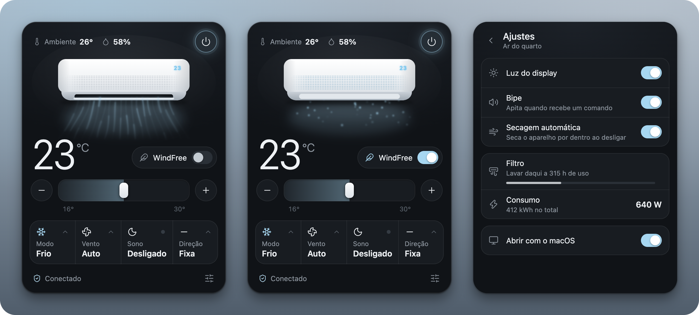
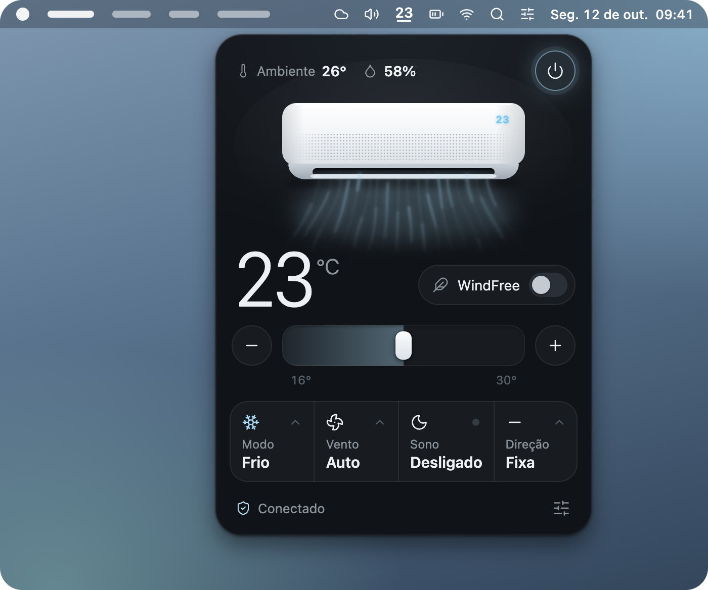

<div align="center">
  
  <h1>WindFree</h1>
  <p>Controle o ar-condicionado Samsung WindFree pela barra de menus do Mac ou pela bandeja do Windows.</p>
  <p>
    <a href="https://github.com/kevinnfsilva/samsung-windfree-menubar-app/releases/latest"></a>
    
    
    
  </p>
  <p>
    <a href="#baixar-para-mac">Baixar para Mac</a> ·
    <a href="#o-que-dá-para-fazer">O que dá para fazer</a> ·
    <a href="#uso">Uso</a> ·
    <a href="#rodar-pelo-código-fonte">Código-fonte</a> ·
    <a href="#no-windows">Windows</a> ·
    <a href="#problemas-comuns">Problemas comuns</a>
  </p>
</div>



Um painel na barra de menus do Mac para controlar o ar-condicionado Samsung WindFree pelo SmartThings. O ícone mostra a temperatura programada e, com um clique, abre o painel.

Este projeto é baseado no [app de bandeja para Windows](https://github.com/c0dag/samsung-windfree-tray-app) do [@c0dag](https://github.com/c0dag), que foi portado aqui para a barra de menus do macOS. O suporte ao Windows do original foi mantido.

## Baixar para Mac

Você precisa de:

- macOS 13 ou mais novo
- O ar já configurado no app SmartThings, numa conta Samsung

Não precisa instalar o Node.js: o app instalado já traz tudo o que usa.

Baixe o instalador na página da [última versão](https://github.com/kevinnfsilva/samsung-windfree-menubar-app/releases/latest):

| Seu Mac | Arquivo |
|---|---|
| Apple Silicon (M1 ou mais novo) | o que termina em `-arm64.dmg` |
| Intel | o que termina em `-x64.dmg` |

Na dúvida, abra o menu Apple e escolha **Sobre Este Mac**. Se aparecer "Chip", é Apple Silicon. Se aparecer "Processador", é Intel.

### Instalar

1. Abra o DMG e arraste o **WindFree** para a pasta **Aplicativos**.
2. Abra o WindFree pela pasta Aplicativos. Na primeira vez o macOS bloqueia; veja logo abaixo como liberar.
3. O app não abre janela nem aparece no Dock. Ele fica só na barra de menus, perto do relógio.

O app não se atualiza sozinho. Para trocar de versão, saia do app, baixe o DMG novo e substitua o app na pasta Aplicativos. Talvez seja preciso liberar a abertura de novo.

### Liberar a primeira abertura

O WindFree não é notarizado (autenticado) pela Apple. A notarização exige uma conta paga de desenvolvedor, que este projeto não tem, então o app sai só com uma assinatura local (ad-hoc). Por isso o macOS bloqueia a primeira abertura.

Para liberar:

1. Tente abrir o WindFree e feche o aviso que aparece, sem mover o app para o Lixo.
2. Abra **Ajustes do Sistema > Privacidade e Segurança** e role até a parte de **Segurança**.
3. Clique em **Abrir Mesmo Assim** ao lado do aviso sobre o WindFree e confirme com a senha ou o Touch ID.

Se preferir o Terminal, este comando remove o bloqueio:

```sh
xattr -dr com.apple.quarantine /Applications/WindFree.app
```

Ele tira a marca de quarentena que o macOS põe nos arquivos baixados da internet. Depois disso o app abre normalmente.

Se não quiser confiar num app não notarizado, dá para [rodar pelo código-fonte](#rodar-pelo-código-fonte). É o mesmo programa.

### Primeiro uso

1. O navegador abre pedindo login na conta Samsung. É o login oficial do SmartThings CLI; entre e autorize.
2. O app procura o primeiro ar-condicionado da sua conta e guarda qual é no arquivo `device.json`.
3. O ícone na barra de menus, que mostra `--` enquanto conecta, passa a mostrar a temperatura.

Cada tentativa espera cerca de dois minutos pelo login. Se você demorar mais que isso, o painel mostra "Sem resposta do SmartThings": termine o login no navegador e clique em **Tentar de novo**. Enquanto isso o app não fica tentando sozinho, para não abrir uma aba nova a cada tentativa.

Depois disso o app abre sozinho com o macOS. Dá para desligar no menu do ícone ou nos ajustes do painel.

Com a barra de menus cheia, o que é comum nos MacBooks com notch, o ícone novo pode ficar escondido. Segure ⌘ e arraste os ícones para reorganizar, ou feche algum que não usa. Abrir o WindFree de novo pela pasta Aplicativos também mostra o painel.

## O que dá para fazer

- Ligar e desligar, e mudar a temperatura de 16 a 30 °C pela barra ou pelos botões − e +
- Trocar o modo (resfriar, desumidificar, ventilar ou automático), a velocidade do vento e a direção da aleta
- Ligar o WindFree e o modo sono
- Ver a temperatura e a umidade medidas pelo próprio ar
- Nos ajustes: luz do display, bipe, secagem automática, uso do filtro e consumo de energia
- Abrir junto com o sistema (dá para desligar nos ajustes)

O desenho do ar no painel segue o estado real do aparelho. O vento muda de cor com o modo (azul no frio, verde no seco), de ritmo com a velocidade e balança conforme a direção escolhida. No WindFree a aleta fecha e o ar sai pelos microfuros, como no aparelho de verdade.

Testado num Samsung WindFree de 9.000 BTUs só frio, modelo 2024. Outros WindFree devem funcionar, mas alguns ajustes podem não existir no seu modelo. Esse teste foi feito com o app original, no Windows. A versão para Mac foi testada só com um aparelho simulado, ainda não com um ar de verdade, e o lado Windows não foi testado de novo depois do porte.

## Uso

### O ícone na barra de menus

<p align="center">
  
</p>

<p align="center"><sub>Ilustração. A barra de menus é um desenho; o painel é o do app.</sub></p>

- O ícone é a temperatura programada. Com o ar ligado aparece um traço embaixo do número. Com o ar desligado o número fica mais apagado e sem o traço.
- Clique no ícone para abrir o painel. Clique de novo, clique fora ou aperte Esc para fechar.
- Clique com o botão direito (ou com dois dedos no trackpad) para abrir o menu: **Abrir painel**, **Ligar** ou **Desligar**, **Atualizar agora**, **Abrir com o macOS** e **Sair**.
- Deixe o mouse parado sobre o ícone para ver se o ar está ligado, além da temperatura e da umidade do ambiente.
- O app fica só na barra de menus, sem ícone no Dock. Para fechar de vez, use **Sair** no menu.

### O painel

- O botão no canto superior direito liga e desliga o ar. O do canto inferior direito abre os ajustes.
- Com o ar desligado, mudanças de temperatura, modo, vento, direção, WindFree e sono ficam guardadas e são aplicadas quando você liga. O aparelho ignora esses ajustes enquanto está desligado, e o rodapé mostra "Aplica quando ligar".
- O rodapé mostra "Sincronizando…" enquanto o comando vai para o ar e avisa quando ele não confirma alguma mudança.

### Abrir com o macOS

Depois da primeira abertura o app passa a abrir sozinho quando você inicia a sessão no Mac. Para desligar, desmarque **Abrir com o macOS** no menu do ícone ou nos ajustes do painel.

Por baixo dos panos, é um LaunchAgent: o arquivo `~/Library/LaunchAgents/io.github.kevinnfsilva.windfree.plist`. O macOS pode avisar que um item em segundo plano foi adicionado. Se mover o app de lugar, saia dele pelo menu **Sair** e abra de novo para atualizar o início automático.

## Mais de um ar na mesma conta

O app usa o primeiro ar que encontrar e guarda a escolha no arquivo `device.json`:

- App instalado no Mac: `~/Library/Application Support/WindFree/device.json`
- Rodando pelo código-fonte, no Mac ou no Windows: `device.json` na pasta do projeto

Para abrir a pasta do app instalado:

```sh
open ~/Library/Application\ Support/WindFree
```

Para escolher outro ar você precisa do ID do aparelho. Na pasta do projeto, depois do `npm install`, rode:

```sh
npx smartthings devices
```

Só instalou o app pelo DMG? O ID também aparece na página do aparelho em [my.smartthings.com/advanced](https://my.smartthings.com/advanced), entrando com a mesma conta Samsung.

Copie o ID e coloque no `device.json`:

```json
{ "id": "ID-DO-APARELHO", "nome": "Ar da sala" }
```

Use **Atualizar agora** no menu do ícone para o app ler o arquivo de novo. Apagar o `device.json` faz o app procurar de novo.

## Rodar pelo código-fonte

Funciona no Mac e no Windows. No Windows é o único jeito, porque não há instalador.

Requisitos:

- macOS 13 ou mais novo, ou Windows 10 ou 11
- [Node.js](https://nodejs.org) 24.8 ou mais novo (é o que o SmartThings CLI pede)
- O ar já configurado no app SmartThings, numa conta Samsung

Baixe o código:

```sh
git clone https://github.com/kevinnfsilva/samsung-windfree-menubar-app.git
```

Entre na pasta:

```sh
cd samsung-windfree-menubar-app
```

Instale as dependências:

```sh
npm install
```

Abra o app:

```sh
npm start
```

Sem git, baixe pelo botão **Code > Download ZIP**, extraia e rode `npm install` e `npm start` dentro da pasta.

O primeiro uso é igual ao do app instalado: o navegador abre para o login na conta Samsung, o app escolhe o primeiro ar da conta e o ícone aparece. O `device.json` fica na pasta do projeto.

Depois disso ele abre sozinho com o sistema. Se mover a pasta de lugar, saia do app e rode `npm start` de novo para atualizar o início automático.

### Gerar os instaladores do Mac

Num Mac, depois do `npm install`:

```sh
npm run dist
```

Os arquivos `.dmg` saem na pasta `dist/`.

## No Windows

No Windows o app roda direto da pasta do projeto, com o Node.js. Não há instalador: siga os passos de [Rodar pelo código-fonte](#rodar-pelo-código-fonte).


- O ícone com a temperatura fica na bandeja, no canto do relógio.
- O Windows 11 esconde ícones novos na setinha ^ da bandeja. Para deixar o ícone sempre à vista, arraste-o para a barra ou ative em **Configurações > Personalização > Barra de tarefas > Outros ícones da bandeja**, onde ele aparece como "Electron".
- Clique no ícone para abrir o painel. Clique fora ou aperte Esc para fechar.
- Clique com o botão direito no ícone para ligar ou desligar, atualizar, escolher se abre com o Windows ou sair.
- Depois da primeira vez ele abre sozinho com o Windows. Se mover a pasta de lugar, rode `npm start` de novo para atualizar o início automático.

## Linha de comando

O script que o app usa também funciona sozinho. Rode na pasta do projeto, com o Node.js instalado.

Ver o estado do ar:

```sh
node ac.mjs status
```

Ligar em 22 °C no modo frio:

```sh
node ac.mjs liga temp 22 modo cool
```

Ligar o WindFree:

```sh
node ac.mjs extra windFree
```

Desligar:

```sh
node ac.mjs desliga
```

| Ação | Valores |
|---|---|
| `liga`, `desliga` | |
| `temp` | 16 a 30 |
| `modo` | `cool`, `dry`, `wind`, `auto` |
| `vento` | `auto`, `low`, `medium`, `high`, `turbo` |
| `extra` | `off`, `windFree`, `windFreeSleep`, `sleep`, `quiet`, `speed` |
| `oscilar` | `fixed`, `vertical`, `horizontal`, `all` |
| `display`, `bipe`, `autoclean` | `on`, `off` |
| `filtroAlerta` | 180, 300, 500 ou 700 horas até avisar para lavar o filtro |
| `zera-filtro` | zera o contador do filtro depois de lavar |

As ações rodam na ordem em que aparecem. A saída é uma linha JSON com o estado do ar, e o campo `pendente` lista o que o aparelho não confirmou. Também existem `tropical`, `limpeza` e `diagnostico`, que ainda foram pouco testados.

## Como funciona

- O app conversa com o ar pela API oficial do SmartThings, usando o login do [SmartThings CLI](https://github.com/SmartThingsCommunity/smartthings-cli). Esse login se renova sozinho e só pede para entrar de novo depois de 30 dias sem uso. Os tokens pessoais do SmartThings expiram em 24 horas, por isso o app não usa esse caminho.
- `ac.mjs` transforma as ações em comandos do SmartThings e confere se o ar aplicou cada um.
- `bridge.js` organiza a fila de comandos. Cliques seguidos viram um comando só.
- `main.js` cuida do ícone, do painel e do início automático, e `panel/` é a interface.
- O app relê o estado do ar a cada 15 segundos com o painel aberto e a cada minuto com ele fechado, para acompanhar o que muda por fora, como pelo controle remoto ou pelo app SmartThings.
- No Mac esses scripts rodam no Node que já vem dentro do Electron, por isso o app instalado não precisa do Node.js. No Windows o app usa o Node instalado no sistema.

Tudo roda no seu computador. O login fica guardado na pasta de configuração do SmartThings CLI, e o app só fala com a API da Samsung.

## Problemas comuns

- **O macOS não deixa abrir o app**: é o bloqueio de apps não notarizados. Veja [Liberar a primeira abertura](#liberar-a-primeira-abertura). Se o aviso disser que o app "está danificado", use o comando `xattr` dessa mesma seção.
- **O ícone não aparece na barra de menus do Mac**: com a barra cheia ele pode estar escondido atrás do notch. Segure ⌘ e arraste os ícones para reorganizar, ou feche algum que não usa. Para chegar ao painel mesmo assim, abra o WindFree de novo pela pasta Aplicativos.
- **O app não abriu sozinho com o macOS**: confira se **Abrir com o macOS** está marcado no menu do ícone. O início automático só é registrado com o app num lugar fixo, como a pasta Aplicativos. Se você abriu direto do DMG, saia do app pelo menu **Sair**, arraste para Aplicativos e abra de novo.
- **"Sem resposta do SmartThings"**: confira no app SmartThings se o ar está online e clique em "Tentar de novo" no painel. No primeiro uso, isso também aparece se o login no navegador demorar mais de dois minutos.
- **O navegador abriu sozinho**: o login expirou depois de 30 dias sem uso. Entre de novo na conta Samsung.
- **"Nenhum ar-condicionado encontrado"**: o login precisa ser na mesma conta em que o ar aparece no app SmartThings.
- **"O ar não confirmou…"**: alguns modos não aceitam todos os ajustes. O painel volta para o estado real do aparelho.

## Desinstalar

No Mac:

1. Desligue **Abrir com o macOS** no menu do ícone ou nos ajustes do painel.
2. Clique em **Sair** no menu do ícone.
3. Apague o WindFree da pasta Aplicativos. Se você roda pelo código-fonte, apague a pasta do projeto.
4. Se quiser, apague também a pasta `~/Library/Application Support/WindFree`, onde ficam o `device.json` do app instalado e as configurações, e a pasta `~/Library/Application Support/@smartthings`, onde o SmartThings CLI guarda o login.

Apagou o app antes de desligar o início automático? Remova o arquivo que sobrou:

```sh
rm ~/Library/LaunchAgents/io.github.kevinnfsilva.windfree.plist
```

No Windows, desligue "Abrir com o Windows" nos ajustes, clique em **Sair** no menu do ícone e apague a pasta.

## Créditos

- O app original, para a bandeja do Windows, é o [samsung-windfree-tray-app](https://github.com/c0dag/samsung-windfree-tray-app) do [@c0dag](https://github.com/c0dag). Este projeto portou o app para a barra de menus do macOS e manteve o suporte ao Windows.
- O original foi inspirado no app de barra de menus que o [@icanberk](https://x.com/icanberk/status/2109031477484937571) fez para o ar dele no macOS.
- Ícones do [Lucide](https://lucide.dev).

Projeto independente, sem vínculo com a Samsung.
