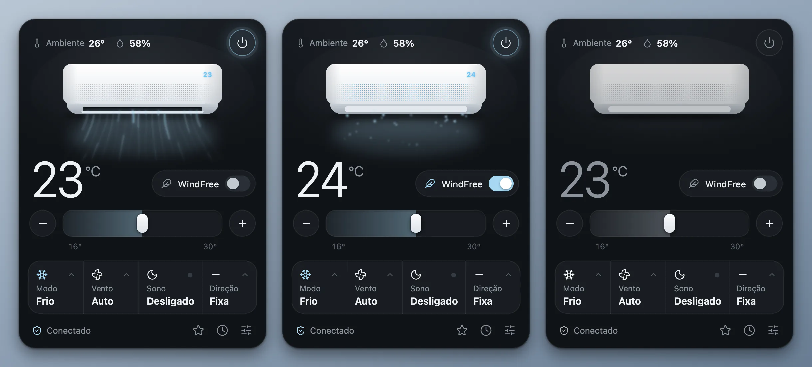
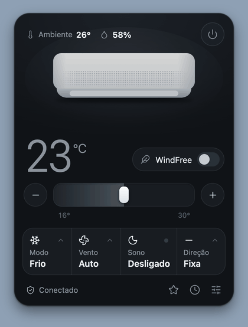
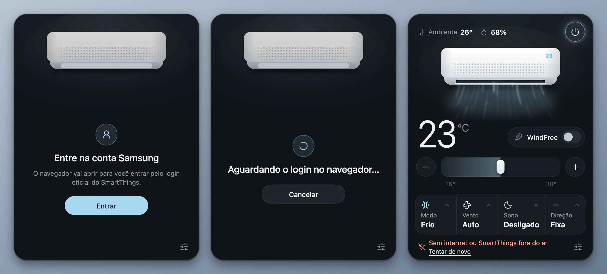
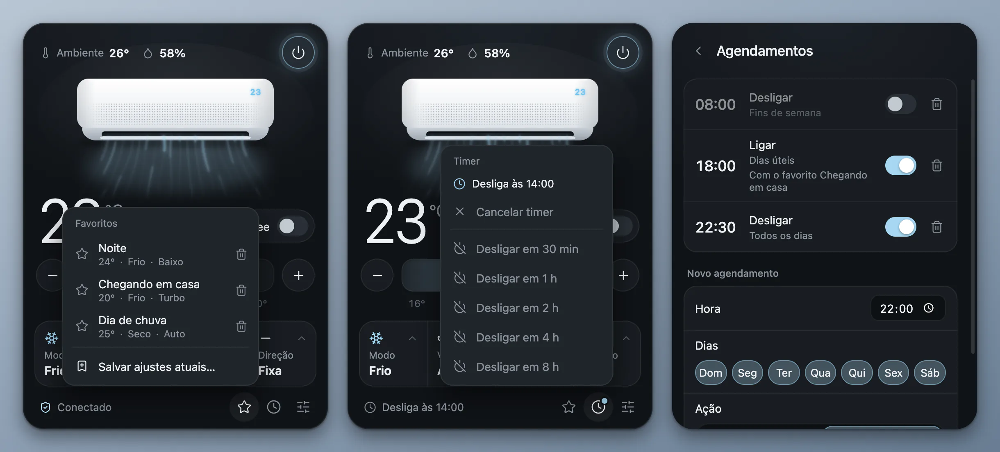
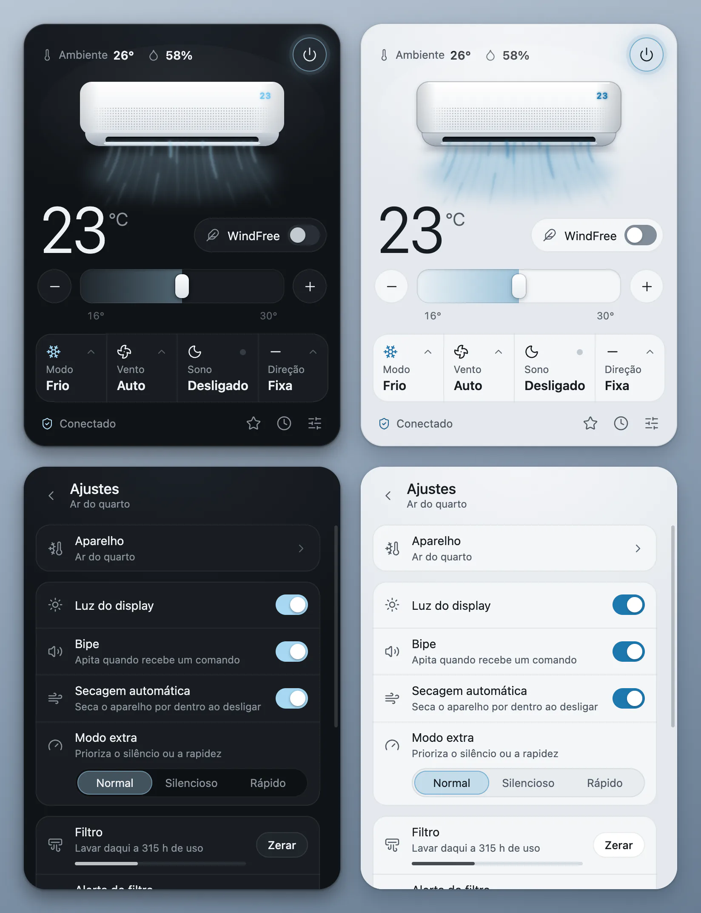
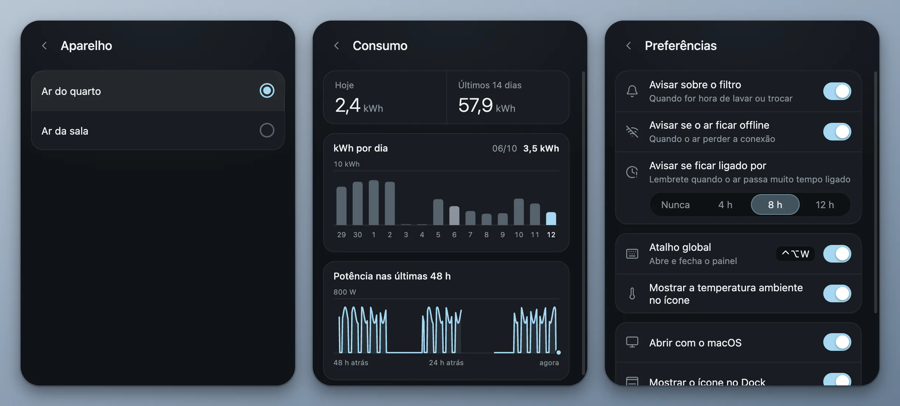

<p align="right"><b>Português</b> · <a href="README.en.md">English</a></p>

<div align="center">
  
  <h1>WindFree</h1>
  <p>Controle o ar-condicionado Samsung WindFree pela barra de menus do Mac ou pela bandeja do Windows.</p>
  <p>
    <a href="https://github.com/kevinnfsilva/samsung-windfree-menubar-app/releases/latest"></a>
    
    
    
  </p>
  <p>
    <a href="#baixar-para-mac">Baixar para Mac</a> ·
    <a href="#o-que-dá-para-fazer">O que dá para fazer</a> ·
    <a href="#uso">Uso</a> ·
    <a href="#rodar-pelo-código-fonte">Código-fonte</a> ·
    <a href="#no-windows">Windows</a> ·
    <a href="#linha-de-comando">Linha de comando</a> ·
    <a href="#problemas-comuns">Problemas comuns</a>
  </p>
</div>

<p align="center">
  
</p>

Um painel na barra de menus do Mac para controlar o ar-condicionado Samsung WindFree pelo SmartThings. O ícone mostra a temperatura programada e, com um clique, abre o painel.

Este projeto é baseado no [app de bandeja para Windows](https://github.com/c0dag/samsung-windfree-tray-app) do [@c0dag](https://github.com/c0dag), que foi portado aqui para a barra de menus do macOS. O suporte ao Windows do original foi mantido.

<p align="center">
  
</p>

<p align="center"><sub>As imagens e a demonstração saem do código real do painel, com um aparelho simulado. O ponteiro do vídeo foi desenhado por cima.</sub></p>

## Baixar para Mac

Você precisa de:

- macOS 13 ou mais novo
- O ar já configurado no app SmartThings, numa conta Samsung

Não precisa instalar o Node.js: o app instalado já traz tudo o que usa.

Baixe o instalador na página da [última versão](https://github.com/kevinnfsilva/samsung-windfree-menubar-app/releases/latest):

| Seu Mac | Arquivo |
|---|---|
| Apple Silicon (M1 ou mais novo) | o que termina em `-arm64.dmg` |
| Intel | o que termina em `-x64.dmg` |

Na dúvida, abra o menu Apple e escolha **Sobre Este Mac**. Se aparecer "Chip", é Apple Silicon. Se aparecer "Processador", é Intel.

### Instalar

1. Abra o DMG e arraste o **WindFree** para a pasta **Aplicativos**.
2. Abra o WindFree pela pasta Aplicativos. Na primeira vez o macOS bloqueia; veja logo abaixo como liberar.
3. O painel abre na hora. O app fica com um ícone na barra de menus, perto do relógio, e outro no Dock. Para ficar só na barra de menus, desligue **Mostrar o ícone no Dock** em **Ajustes > Preferências**.

O app não se atualiza sozinho. Para trocar de versão, saia do app, baixe o DMG novo e substitua o app na pasta Aplicativos. Talvez seja preciso liberar a abertura de novo.

Vindo da versão 1.1.1? O que muda:

- Abrir o app agora abre o painel, e o app tem ícone no Dock (dá para desligar).
- O navegador não abre mais sozinho. Quando falta o login, o painel mostra "Entre na conta Samsung" e você clica em **Entrar**.
- Para trocar de ar-condicionado não precisa mais editar o `device.json`: use **Ajustes > Aparelho**. O seu `device.json` continua valendo.

### Liberar a primeira abertura

O WindFree não é notarizado (autenticado) pela Apple. A notarização exige uma conta paga de desenvolvedor, que este projeto não tem, então o app sai só com uma assinatura local (ad-hoc). Por isso o macOS bloqueia a primeira abertura.

Para liberar:

1. Tente abrir o WindFree e feche o aviso que aparece, sem mover o app para o Lixo.
2. Abra **Ajustes do Sistema > Privacidade e Segurança** e role até a parte de **Segurança**.
3. Clique em **Abrir Mesmo Assim** ao lado do aviso sobre o WindFree e confirme com a senha ou o Touch ID.

Se preferir o Terminal, este comando remove o bloqueio:

```sh
xattr -dr com.apple.quarantine /Applications/WindFree.app
```

Ele tira a marca de quarentena que o macOS põe nos arquivos baixados da internet. Depois disso o app abre normalmente.

Se não quiser confiar num app não notarizado, dá para [rodar pelo código-fonte](#rodar-pelo-código-fonte). É o mesmo programa.

### Primeiro uso

<p align="center">
  
</p>

1. O painel abre com **Entre na conta Samsung**. Clique em **Entrar**.
2. O navegador abre com o login oficial do SmartThings. Entre e autorize. Enquanto isso o painel mostra "Aguardando o login no navegador…", com o botão **Cancelar**.
3. Quando o login termina, o app procura os ar-condicionados da conta e usa o primeiro. Se você tem mais de um, escolha o certo em [**Ajustes > Aparelho**](#mais-de-um-ar-na-mesma-conta). O ícone na barra de menus, que mostra `--` enquanto conecta, passa a mostrar a temperatura.

O navegador só abre quando você clica em **Entrar**, no painel ou no menu do ícone. O app espera o login por cerca de 10 minutos; se passar disso, o painel volta para "Entre na conta Samsung". **Cancelar**, ou sair do app, encerra o login e não deixa nenhum processo em segundo plano. Essas duas garantias, de não abrir o navegador sozinho e de não deixar processos, valem só no Mac.

Depois disso o app abre sozinho com o macOS, sem abrir o painel. Dá para desligar no menu do ícone ou em **Ajustes > Preferências**.

Com a barra de menus cheia, o que é comum nos MacBooks com notch, o ícone novo pode ficar escondido. Segure ⌘ e arraste os ícones para reorganizar, ou feche algum que não usa. Clicar no ícone do app no Dock, ou abrir o WindFree de novo pela pasta Aplicativos, também mostra o painel.

## O que dá para fazer

- Ligar e desligar, e mudar a temperatura pela barra, pelos botões − e + ou pelas setas do teclado. A faixa de temperatura vem do próprio aparelho (16 a 30 °C quando ele não informa).
- Trocar o modo, a velocidade do vento e a direção da aleta. As opções também vêm do aparelho: o modo Aquecer só aparece nos que têm.
- Ligar o WindFree e o modo sono.
- Ver a temperatura e a umidade medidas pelo próprio ar.
- Escolher qual ar-condicionado da conta usar, quando há mais de um.
- Guardar combinações de ajustes como **favoritos** e aplicar com um clique.
- Programar um **timer** (de 30 minutos a 8 horas) e **agendamentos** por horário e dia da semana.
- Ver o **consumo**: kWh por dia e a potência nas últimas 48 horas.
- Receber avisos: filtro para lavar, ar offline e ar ligado há muito tempo.
- Abrir o painel por um atalho global (desligado por padrão).
- Nos ajustes: luz do display, bipe, secagem automática, modo extra (silencioso ou rápido) e o filtro, com contador e alerta. Em **Funções avançadas**: noite tropical, limpeza e diagnóstico.
- Aparência clara ou escura, seguindo o sistema, e telas em português ou inglês.
- Abrir junto com o sistema (dá para desligar).

O desenho do ar no painel segue o estado real do aparelho. O vento muda de cor com o modo (azul no frio, verde no seco), de ritmo com a velocidade e balança conforme a direção escolhida. No WindFree a aleta fecha e o ar sai pelos microfuros, como no aparelho de verdade.

Testado num Samsung WindFree de 9.000 BTUs só frio, modelo 2024. Outros WindFree devem funcionar, mas alguns ajustes podem não existir no seu modelo; o painel só mostra o que o aparelho informa. Esse teste foi feito com o app original, no Windows.

Na 1.2.0, a versão para Mac foi testada pela primeira vez com um Samsung WindFree de verdade: ler o estado, listar os aparelhos da conta, ligar e desligar e mudar a temperatura funcionaram. Um timer de desligar também foi disparado no ar de verdade. Os agendamentos, os avisos e o atalho global foram testados só com um aparelho simulado. Os outros ajustes (modo, vento, direção, WindFree, sono, filtro e o resto) não foram repetidos nesta versão com um ar de verdade. O lado Windows não foi testado de novo.

## Uso

### O ícone na barra de menus

<p align="center">
  
</p>

<p align="center"><sub>Ilustração. A barra de menus é um desenho; os ícones são os do app.</sub></p>

1. Ar ligado: a temperatura programada com um traço embaixo.
2. Ar desligado: um símbolo de liga e desliga.
3. Com **Mostrar a temperatura ambiente no ícone** ligado em **Ajustes > Preferências**, a temperatura medida aparece ao lado, com um termômetro.
4. Sem login, ou antes de o app ler o estado do ar: `--`.

- Clique no ícone para abrir o painel. Clique de novo, clique fora ou aperte Esc para fechar.
- Clique com o botão direito (ou com dois dedos no trackpad) para abrir o menu: **Abrir painel**, **Ligar** ou **Desligar**, **Favoritos** (quando há algum), **Atualizar agora**, **Abrir com o macOS** e **Sair**. Sem login, o menu mostra **Entrar na conta Samsung** no lugar de **Ligar**, **Favoritos** e **Atualizar agora**.
- Deixe o mouse parado sobre o ícone para ver se o ar está ligado, além da temperatura e da umidade do ambiente.
- Para fechar o app de vez, use **Sair** no menu do ícone.

### O painel

- O botão no canto superior direito liga e desliga o ar. No rodapé ficam a estrela dos favoritos, o relógio do timer e o botão dos ajustes.
- Com o ar desligado, mudanças de temperatura, modo, vento, direção, WindFree e sono ficam guardadas e são aplicadas quando você liga. O aparelho ignora esses ajustes enquanto está desligado, e o rodapé mostra "Aplica quando ligar".
- O rodapé mostra "Sincronizando…" enquanto o comando vai para o ar e avisa quando ele não confirma alguma mudança.
- Quando algo dá errado, o rodapé diz o quê: "Sem internet ou SmartThings fora do ar", "O ar está offline", "Nenhum ar-condicionado nesta conta", "Este ar não está mais na conta" (com o atalho **Escolher outro ar**), "O SmartThings demorou para responder" ou "Sem resposta do SmartThings". Todos trazem **Tentar de novo**.

### Favoritos, timer e agendamentos

<p align="center">
  
</p>

**Favoritos.** Clique na estrela do rodapé e em **Salvar ajustes atuais…** para guardar temperatura, modo, vento, WindFree, sono e direção com um nome. Clicar num favorito aplica esses ajustes e liga o ar. A lixeira apaga. Os favoritos também aparecem no menu do ícone.

**Timer.** Clique no relógio do rodapé. Com o ar ligado, as opções são "Desligar em 30 min", 1 h, 2 h, 4 h e 8 h; com o ar desligado, são as mesmas para ligar. O rodapé mostra "Desliga às…" ou "Liga às…" enquanto o timer está ativo, e **Cancelar timer** o desfaz. Só existe um timer por vez.

**Agendamentos.** Em **Ajustes > Agendamentos**, escolha a hora, os dias da semana e a ação (**Ligar** ou **Desligar**). Ao ligar, dá para usar um favorito. Cada agendamento tem um botão para ativar ou desativar e uma lixeira.

Valem algumas regras para o timer e os agendamentos:

- Cada um fica ligado ao ar que estava em uso quando foi criado e age sobre ele, mesmo que você escolha outro ar depois.
- Eles só rodam com o WindFree aberto. Com o Mac em repouso, nada roda.
- Se o comando não puder ser entregue (sem internet, SmartThings fora do ar), o app tenta de novo a cada minuto, por até 10 minutos, e depois mostra um aviso de que não foi possível ligar ou desligar. Se você fechar o app nesse tempo, ele retoma ao abrir de novo. Ligar ou desligar o ar à mão cancela as tentativas pendentes.
- Um timer de desligar que venceu com o Mac em repouso, ou com o app fechado, dispara assim que o app estiver rodando de novo. Um timer de ligar com mais de 5 minutos de atraso é descartado, e o app avisa.
- Um agendamento só dispara no minuto marcado. Se o app estiver fechado ou o Mac em repouso nesse minuto, ele não é recuperado.

### Consumo

Em **Ajustes > Consumo** ficam o consumo de hoje e dos últimos 14 dias, o gráfico de kWh por dia e a potência nas últimas 48 horas. Passe o mouse sobre o gráfico para ver o valor de cada ponto.

O app só registra enquanto está aberto, por isso uma instalação nova começa com "Ainda não há dados de consumo". O histórico fica no seu computador, no arquivo `historico.json`.

### Avisos

Em **Ajustes > Preferências** dá para ligar ou desligar cada aviso:

- **Avisar sobre o filtro**: quando for hora de lavar ou trocar. O contador do filtro e o alerta (180, 300, 500 ou 700 horas de uso) ficam em **Ajustes**, com o botão **Zerar** para depois de lavar.
- **Avisar se o ar ficar offline**: quando o ar perder a conexão.
- **Avisar se ficar ligado por**: Nunca, 4 h, 8 h ou 12 h.

### Atalhos

- O **Atalho global** abre e fecha o painel de qualquer lugar. Fica desligado até você ligar em **Ajustes > Preferências**. No Mac é ⌃⌥W (Control + Option + W). Se outro app já usa essa combinação, a chave volta a desligar e o painel avisa "Combinação em uso ou inválida.". Não dá para trocar a combinação pelo painel.
- Com o painel aberto, ↑ e ↓ mudam a temperatura, Espaço liga e desliga o ar e Esc volta um passo: fecha o menu aberto, depois a página dos ajustes, depois os ajustes e por fim o painel. As setas e o Espaço não valem com um menu ou os ajustes abertos, nem com o foco num botão ou campo que já usa a tecla. Logo depois de abrir, o painel ignora ↑, ↓ e Espaço por um instante.

### Aparência e idioma

O painel acompanha o modo claro ou escuro do sistema.

<p align="center">
  
</p>

O idioma fica em **Ajustes > Preferências > Idioma**: Automático, Português ou English. No Automático, o app usa português quando o macOS está em português e inglês em qualquer outro caso. O menu do ícone e os avisos seguem o mesmo idioma.

### Ajustes

<p align="center">
  
</p>

Em **Ajustes** ficam a luz do display, o bipe, a secagem automática, o modo extra (Normal, Silencioso ou Rápido), o filtro e as páginas **Aparelho**, **Consumo**, **Agendamentos**, **Funções avançadas** e **Preferências**. Cada ajuste só aparece se o aparelho informa que tem aquela função.

As **Funções avançadas** (noite tropical, limpeza e diagnóstico) foram pouco testadas no app original e podem não funcionar no seu aparelho.

### Abrir com o macOS

Depois da primeira abertura o app passa a abrir sozinho quando você inicia a sessão no Mac, com o painel fechado. Para desligar, desmarque **Abrir com o macOS** no menu do ícone ou em **Ajustes > Preferências**.

Por baixo dos panos, é um LaunchAgent: o arquivo `~/Library/LaunchAgents/io.github.kevinnfsilva.windfree.plist`. O macOS pode avisar que um item em segundo plano foi adicionado. Se mover o app de lugar, saia dele pelo menu **Sair** e abra de novo para atualizar o início automático.

## Mais de um ar na mesma conta

Abra **Ajustes > Aparelho**. A lista mostra os ar-condicionados da conta; clique no que você quer controlar. Se o ar que você usava saiu da conta, o painel diz "Este ar não está mais na conta" e o atalho **Escolher outro ar** leva até essa lista.

O app guarda a escolha no arquivo `device.json`. Você não precisa mexer nele, mas é bom saber onde fica:

- App instalado no Mac: `~/Library/Application Support/WindFree/device.json`
- Rodando pelo código-fonte, no Mac ou no Windows: `device.json` na pasta do projeto

Para abrir a pasta do app instalado:

```sh
open ~/Library/Application\ Support/WindFree
```

Apagar o `device.json` faz o app procurar de novo e usar o primeiro ar da conta.

## Rodar pelo código-fonte

Funciona no Mac e no Windows. No Windows é o único jeito, porque não há instalador.

Requisitos:

- macOS 13 ou mais novo, ou Windows 10 ou 11
- [Node.js](https://nodejs.org) 24.8 ou mais novo (é o que o SmartThings CLI pede)
- O ar já configurado no app SmartThings, numa conta Samsung

Baixe o código:

```sh
git clone https://github.com/kevinnfsilva/samsung-windfree-menubar-app.git
```

Entre na pasta:

```sh
cd samsung-windfree-menubar-app
```

Instale as dependências:

```sh
npm install
```

Abra o app:

```sh
npm start
```

Sem git, baixe pelo botão **Code > Download ZIP**, extraia e rode `npm install` e `npm start` dentro da pasta.

O primeiro uso é igual ao do app instalado: o painel pede o login, você clica em **Entrar**, o app escolhe o primeiro ar da conta e o ícone aparece. O `device.json` fica na pasta do projeto.

Depois disso ele abre sozinho com o sistema. Se mover a pasta de lugar, saia do app e rode `npm start` de novo para atualizar o início automático.

### Gerar os instaladores do Mac

Num Mac, depois do `npm install`:

```sh
npm run dist
```

Os arquivos `.dmg` saem na pasta `dist/`.

## No Windows

No Windows o app roda direto da pasta do projeto, com o Node.js. Não há instalador: siga os passos de [Rodar pelo código-fonte](#rodar-pelo-código-fonte).

<p align="center">
  
</p>

<p align="center"><sub>Captura da versão 1.1.1 no Windows. O visual mudou na 1.2.0.</sub></p>

- O ícone com a temperatura fica na bandeja, no canto do relógio. Ligado, o número ganha um traço colorido; desligado, fica mais apagado.
- O Windows 11 esconde ícones novos na setinha ^ da bandeja. Para deixar o ícone sempre à vista, arraste-o para a barra ou ative em **Configurações > Personalização > Barra de tarefas > Outros ícones da bandeja**, onde ele aparece como "Electron".
- Clique no ícone para abrir o painel. Clique fora ou aperte Esc para fechar.
- Clique com o botão direito no ícone para entrar na conta, ligar ou desligar, escolher um favorito, atualizar, escolher se abre com o Windows ou sair.
- O painel não abre sozinho quando você inicia o app, e não há ícone no Dock nem a opção de mostrá-lo. O atalho global, quando ligado, é Ctrl+Alt+Shift+W.
- Depois da primeira vez ele abre sozinho com o Windows. Se mover a pasta de lugar, rode `npm start` de novo para atualizar o início automático.
- As novidades da 1.2.0 estão no código do Windows também, mas o Windows não foi testado de novo. A garantia de que o navegador nunca abre sem você pedir e a limpeza dos processos ao cancelar ou sair valem só no Mac.

## Linha de comando

O script que o app usa também funciona sozinho. Rode na pasta do projeto, com o Node.js instalado.

Ver o estado do ar:

```sh
node ac.mjs status
```

Ligar em 22 °C no modo frio:

```sh
node ac.mjs liga temp 22 modo cool
```

Ligar o WindFree:

```sh
node ac.mjs extra windFree
```

Desligar:

```sh
node ac.mjs desliga
```

Listar os ar-condicionados da conta e escolher um:

```sh
node ac.mjs aparelhos
node ac.mjs usar ID-DO-APARELHO
```

Entrar na conta Samsung (abre o navegador):

```sh
node ac.mjs login
```

| Ação | Valores |
|---|---|
| `liga`, `desliga` | |
| `temp` | 16 a 30, ou a faixa que o aparelho informar |
| `modo` | `cool`, `dry`, `wind`, `auto`, e os outros que o aparelho informar, como `heat` |
| `vento` | `auto`, `low`, `medium`, `high`, `turbo` |
| `extra` | `off`, `windFree`, `windFreeSleep`, `sleep`, `quiet`, `speed` |
| `oscilar` | `fixed`, `vertical`, `horizontal`, `all` |
| `display`, `bipe`, `autoclean` | `on`, `off` |
| `filtroAlerta` | 180, 300, 500 ou 700 horas até avisar para lavar o filtro |
| `zera-filtro` | zera o contador do filtro depois de lavar |
| `login` | entra na conta Samsung e depois lê o estado, como `status` |
| `aparelhos` | lista os ar-condicionados da conta, sem outras ações |
| `usar ID` | passa a usar esse ar-condicionado e mostra o estado dele |

As ações rodam na ordem em que aparecem. A saída é uma linha JSON com o estado do ar, e o campo `pendente` lista o que o aparelho não confirmou. Também existem `tropical`, `limpeza` e `diagnostico`, que ainda foram pouco testados.

Quando algo dá errado, o script termina com código 1 e a última linha da saída de erro é um JSON com um código:

```json
{"erro":"login","mensagem":"É preciso entrar na sua conta SmartThings."}
```

Os códigos são `login` (falta entrar na conta), `rede` (sem internet ou SmartThings fora do ar), `sem-ar` (nenhum ar-condicionado na conta), `aparelho` (o ar salvo não está mais na conta) e `desconhecido`. Só o `login` abre o navegador: qualquer outra ação sem login salvo termina com o erro `login`.

## Como funciona

- O app conversa com o ar pela API oficial do SmartThings, usando o login do [SmartThings CLI](https://github.com/SmartThingsCommunity/smartthings-cli). Esse login se renova sozinho e só pede para entrar de novo depois de 30 dias sem uso. Os tokens pessoais do SmartThings expiram em 24 horas, por isso o app não usa esse caminho.
- `ac.mjs` transforma as ações em comandos do SmartThings, confere se o ar aplicou cada um e traduz as falhas em códigos de erro.
- `bridge.js` organiza a fila de comandos. Cliques seguidos viram um comando só.
- `main.js` cuida do ícone, do painel e do início automático. A pasta `lib/` tem os favoritos, o timer e os agendamentos, o histórico de consumo, os avisos e o atalho. A pasta `locales/` tem os textos em português e inglês, e `panel/` é a interface.
- O app relê o estado do ar a cada 15 segundos com o painel aberto e a cada minuto com ele fechado, para acompanhar o que muda por fora, como pelo controle remoto ou pelo app SmartThings. Sem login, ou depois de uma resposta lenta demais, ele para de ler sozinho até você tentar de novo.
- No Mac esses scripts rodam no Node que já vem dentro do Electron, por isso o app instalado não precisa do Node.js. No Windows o app usa o Node instalado no sistema.

Tudo roda no seu computador. O login fica guardado na pasta de configuração do SmartThings CLI. As configurações (preferências, favoritos, timer e agendamentos) ficam em `settings.json` e o consumo em `historico.json`, os dois na pasta de dados do app (no Mac, `~/Library/Application Support/WindFree`). O app só fala com os servidores do SmartThings, da Samsung.

## Problemas comuns

- **O macOS não deixa abrir o app**: é o bloqueio de apps não notarizados. Veja [Liberar a primeira abertura](#liberar-a-primeira-abertura). Se o aviso disser que o app "está danificado", use o comando `xattr` dessa mesma seção.
- **O ícone não aparece na barra de menus do Mac**: com a barra cheia ele pode estar escondido atrás do notch. Segure ⌘ e arraste os ícones para reorganizar, ou feche algum que não usa. Para chegar ao painel mesmo assim, clique no ícone do app no Dock ou abra o WindFree de novo pela pasta Aplicativos.
- **Não quero o ícone no Dock**: desligue **Mostrar o ícone no Dock** em **Ajustes > Preferências**. O app fica só na barra de menus.
- **O painel não abriu quando liguei o Mac**: é de propósito. Aberto pelo início automático, o app fica quieto; clique no ícone da barra de menus.
- **O app não abriu sozinho com o macOS**: confira se **Abrir com o macOS** está marcado no menu do ícone. O início automático só é registrado com o app num lugar fixo, como a pasta Aplicativos. Se você abriu direto do DMG, saia do app pelo menu **Sair**, arraste para Aplicativos e abra de novo.
- **"Entre na conta Samsung"**: o app ainda não tem um login, ou o login expirou depois de 30 dias sem uso. Clique em **Entrar**. Se o navegador não abrir, ou você fechou a aba sem terminar, clique em **Cancelar** e em **Entrar** de novo.
- **"Sem internet ou SmartThings fora do ar"**: confira a conexão e o app SmartThings, e clique em **Tentar de novo**.
- **"O SmartThings demorou para responder"**: clique em **Tentar de novo**. Até lá o app não atualiza sozinho.
- **"O ar está offline"**: o aparelho perdeu a energia ou o Wi-Fi. Confira os dois; o app avisa quando ele volta.
- **"Nenhum ar-condicionado nesta conta"**: o login precisa ser na mesma conta em que o ar aparece no app SmartThings.
- **"Este ar não está mais na conta"**: clique em **Escolher outro ar** e escolha um dos que aparecem.
- **"O ar não confirmou…"**: alguns modos não aceitam todos os ajustes. O painel volta para o estado real do aparelho.
- **O atalho global não funciona**: outro app pode estar usando a combinação. O painel mostra "Combinação em uso ou inválida." e desliga a chave.

## Desinstalar

No Mac:

1. Desligue **Abrir com o macOS** no menu do ícone ou em **Ajustes > Preferências**.
2. Clique em **Sair** no menu do ícone.
3. Apague o WindFree da pasta Aplicativos. Se você roda pelo código-fonte, apague a pasta do projeto.
4. Se quiser, apague também a pasta `~/Library/Application Support/WindFree`, onde ficam o `device.json` do app instalado, as configurações e o histórico de consumo, e a pasta `~/Library/Application Support/@smartthings`, onde o SmartThings CLI guarda o login.

Apagou o app antes de desligar o início automático? Remova o arquivo que sobrou:

```sh
rm ~/Library/LaunchAgents/io.github.kevinnfsilva.windfree.plist
```

No Windows, desligue "Abrir com o Windows" nos ajustes, clique em **Sair** no menu do ícone e apague a pasta.

## Créditos

- O app original, para a bandeja do Windows, é o [samsung-windfree-tray-app](https://github.com/c0dag/samsung-windfree-tray-app) do [@c0dag](https://github.com/c0dag). Este projeto portou o app para a barra de menus do macOS e manteve o suporte ao Windows.
- O original foi inspirado no app de barra de menus que o [@icanberk](https://x.com/icanberk/status/2109031477484937571) fez para o ar dele no macOS.
- Ícones do [Lucide](https://lucide.dev).

Projeto independente, sem vínculo com a Samsung.
